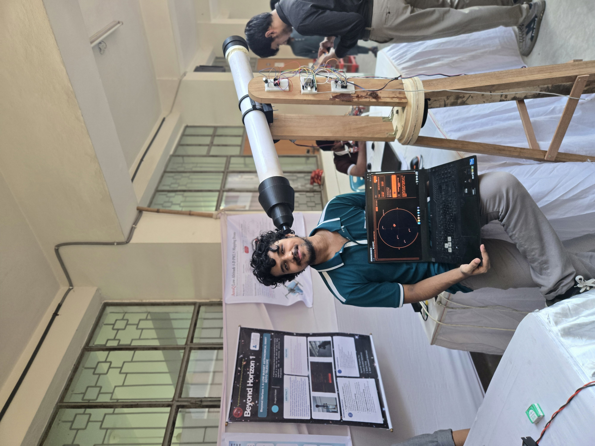
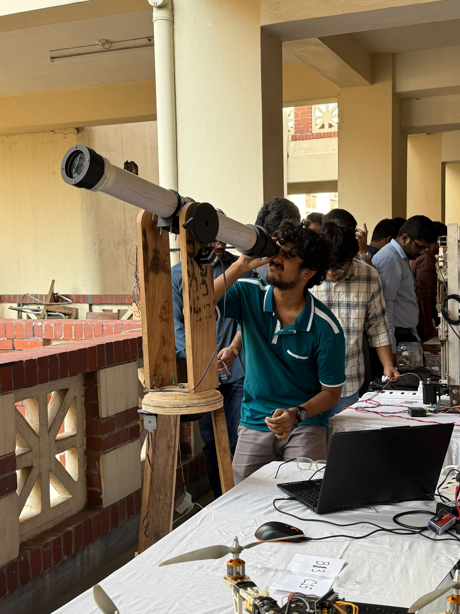
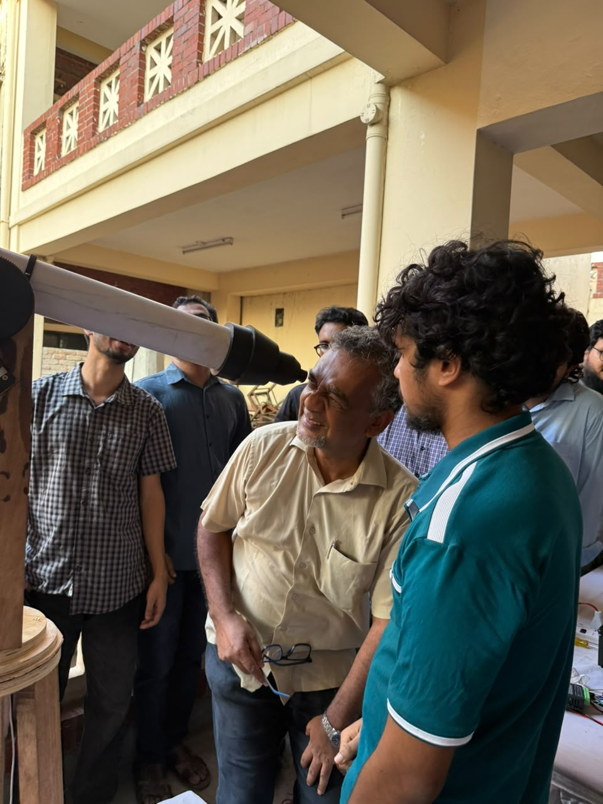
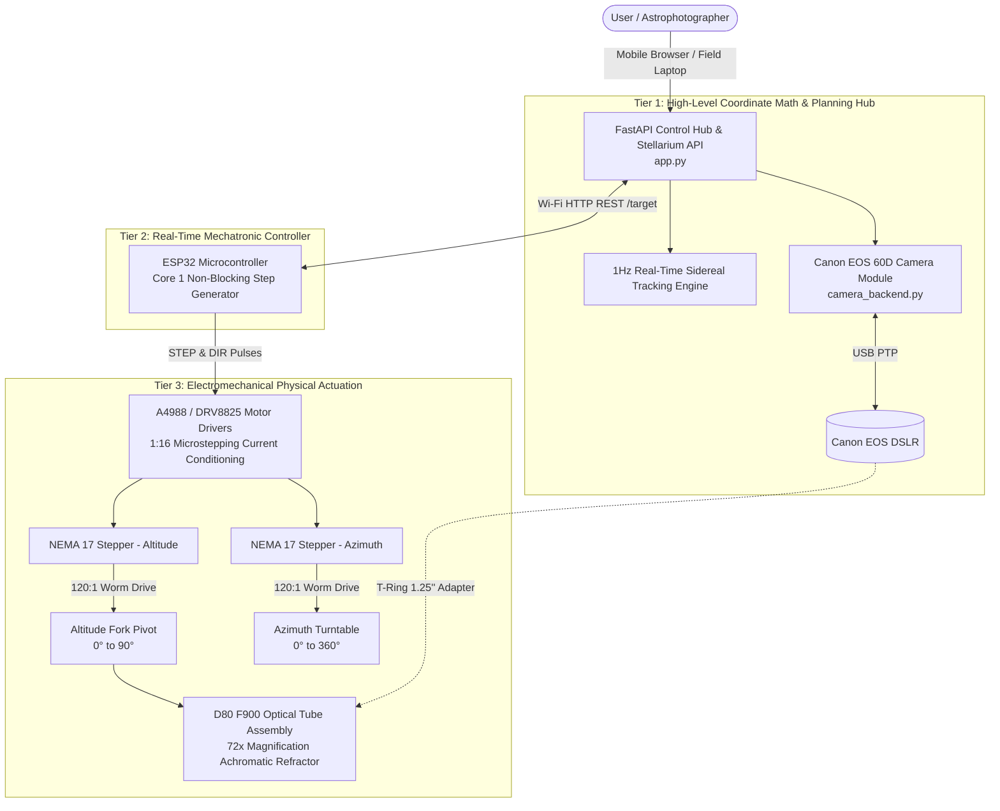

# 🔭 BEYOND HORIZON — 1 (BH-1)
### *An Automated High-Magnification Alt-Azimuth Computerized Telescope Mount*

**Designed · Fabricated · Automated · Photographed — from the ground up**

[](#)
[](#)
[](#)
[](#)
[](#)
[](#)
[](#)

---

<div align="center">
  
  <p><em>Figure 1: Fully assembled Beyond Horizon - 1 (BH-1) computerized refractor telescope on custom Alt-Az fork mount and field tripod.</em></p>
</div>

---

## 📖 Executive Summary

**Project Beyond Horizon - 1 (BH-1)** is an electro-mechanical, computerized smart GoTo astronomical telescope developed as an electro-mechanical system design capstone (**ME 366, Group B-3**) at the **Department of Mechanical Engineering, Bangladesh University of Engineering and Technology (BUET)**.

Commercial motorized GoTo telescopes with computerized celestial tracking and astrophotography integration are prohibitively expensive and rely entirely on imports in Bangladesh. **BH-1** bridges this gap by democratizing astronomy: integrating precision optomechanics, 3D-printed polymers and rigid PVC fabrication, high-torque dual-axis worm gear drives, an ESP32 wireless motion controller, a FastAPI night-vision tactical dashboard, and dedicated Canon EOS DSLR astrophotography integration—all fabricated within an accessible budget of **~26,600 BDT (~$220 USD)**.

---

## 📸 Prototype & Simulation Gallery

| Field Tripod Setup | 120:1 Worm Drive & Focuser | COMSOL Ray Tracing Simulation |
| :---: | :---: | :---: |
|  |  |  |
| *Full optical tube and fork assembly* | *Precision drive mechanics & eyepiece clamp* | *Polychromatic beam convergence analysis* |

---

## 🌟 Key Highlights & Features

- **🔭 High-Resolution D80 F900 Achromatic Optics**:
  - D80 F900 Achromatic doublet objective lens ($80\text{ mm}$ clear aperture, $900\text{ mm}$ focal length, $f/11.25$ focal ratio).
  - Capable of up to **72x maximum optical magnification** for resolving lunar craters and planetary disks (Jupiter's Galilean moons, Saturn's rings).
  - Paraxial focal convergence verified at $z = 899.484\text{ mm}$ with $r_{\text{rms}} = 68.1\,\mu\text{m}$ RMS spot radius across the visible polychromatic spectrum ($400\text{--}700\text{ nm}$).
  - Thin-film Anti-Reflective (AR) coating verified via **COMSOL Multiphysics** ray tracing to eliminate internal ghost reflections.
- **⚙️ Dual-Axis Motorized Alt-Azimuth Mount**:
  - 2 Degrees of Freedom (Altitude: $0^\circ \text{ to } 90^\circ$, Azimuth: $0^\circ \text{ to } 360^\circ$).
  - High-torque NEMA 17 stepper motors paired with custom **120:1 Worm Gearboxes** for non-backdrivable, zero-sag holding and micro-smooth slewing.
  - Sub-arcminute theoretical resolution: **1,066.67 steps/degree** ($384,000\text{ steps/rev}$ at $1/16$ microstepping $\implies 3.375\text{ arcsec/step}$).
- **📡 Wireless ESP32 Motion Controller**:
  - Standalone Wi-Fi HTTP REST API (`/target`, `/calibrate`, `/status`).
  - Interleaved non-blocking step generation on ESP32 Core 1 with FreeRTOS queues.
  - Decoupled, degree-based kinematics calculation local to firmware.
- **🛰️ Real-Time 1 Hz Sidereal Tracking Engine**:
  - Continuously counteracts Earth’s diurnal rotation ($\approx 15.041^\circ/\text{hr} \approx 0.004167^\circ/\text{sec}$) to maintain precise optical centering on celestial targets.
- **🖥️ Tactical Night-Vision Web Dashboard**:
  - Responsive single-page application built with FastAPI, WebSockets/HTTP, HTML5 Canvas, and modern vanilla CSS.
  - Dark-adapted red/charcoal theme (`#050505` / `#ef4444`) to preserve visual rod-cell adaptation in field conditions.
  - Interactive pannable & zoomable celestial sky map with target search, real-time coordinate translation, and tactile virtual D-Pad slewing.
  - 3-Way Calibration Suite: Star/Object Sync, Cardinal Horizon Alignment, and Direct Coordinate Entry.
- **📷 Canon EOS DSLR Astrophotography & Intervalometer**:
  - Native USB PTP camera control (Canon EOS 60D) with automated hardware simulation fallback.
  - Live-view stream over MJPEG with tactical crosshair reticle overlay.
  - Full exposure controls (Shutter speeds up to BULB, ISO 100–12800, Aperture, White Balance).
  - Multi-frame astrophotography intervalometer with progress bar telemetry and local image capture storage.

---

## 🏛️ Hierarchical Three-Tier System Architecture

As documented in the official **ME-366 Final Report (Group B-3)**, the system implements a robust three-tier control architecture:



---

## 🛠️ Engineering Challenges & Iterative Redesigns

During prototype development and testing, several real-world engineering hurdles were solved through rapid mechatronic iteration:

1. **Metal Machining vs. 3D Printing**:
   - *Problem*: Initial attempts to machine metal 120:1 worm gear sets failed due to local machine-shop tooling constraints and pitch tolerance limits.
   - *Solution*: Re-engineered parametric models in SolidWorks specifically optimized for FDM additive manufacturing with tight tooth clearances.
2. **Worm Screw Torsional Shearing**:
   - *Problem*: The initial 3D-printed worm screw experienced shear failure along layer lines under motor holding torque and dynamic stopping loads.
   - *Solution*: Re-oriented print layer axes to eliminate shear planes perpendicular to torque, increased functional infill to 100%, and integrated sleeve bearings to absorb axial thrust loads.
3. **Firmware Decoupling**:
   - *Problem*: Initial designs relied on host-side raw motor step commands, causing network latency jitter in movement smoothness.
   - *Solution*: Upgraded communication to pure degree telemetry (`target_alt`, `target_az`), delegating trapezoidal acceleration and deterministic pulse synthesis to ESP32 Core 1.

---

## 📂 Repository Directory Structure

```text
Beyond_Horizon_1/
├── CADS/                               # Consolidated SolidWorks 3D CAD models, assemblies & printables
│   ├── final assembly.SLDASM           # Master telescope & mount optomechanical assembly
│   ├── Assem lower platform.SLDASM     # Azimuth turntable & thrust bearing assembly
│   ├── Assembly for print.SLDASM       # Print-ready subassembly for rapid prototyping
│   ├── Lens cap and cell.SLDASM        # Objective lens cell & protective dust cap
│   ├── Lower Holder finalized.STL      # 3D printable lower structural clamp
│   ├── Draw tube.SLDPRT                # 1.25" optical draw tube for eyepiece/camera
│   ├── Focuser Static.SLDPRT           # Static focuser barrel housing
│   ├── Lens Cell.SLDPRT & Lens cap     # 80mm doublet lens cell & threaded cap
│   ├── Main tube.SLDPRT                # Primary optical tube assembly (OTA) body
│   ├── Upper Holder.SLDPRT             # Upper mounting clamp
│   ├── Lower Holder.SLDPRT             # Lower mounting clamp
│   ├── Lower Part with the shaft.SLDPRT# Main rotational shaft connector
│   ├── wormscrew.SLDPRT                # Precision worm screw (NEMA 17 driven)
│   ├── wormwheel.SLDPRT                # 120-tooth worm wheel (120:1 gear reduction)
│   ├── bases.SLDPRT & standing part    # Rigid base plate & vertical fork uprights
│   └── leg.SLDPRT, upper/lower shafts  # Tripod mounting legs and stainless steel shafts
│
├── FEA Simulation/                     # Computational optical ray tracing & finite element analysis
│   ├── FEA Model (Objective Lens).mph  # COMSOL Multiphysics polychromatic ray tracing model
│   └── Results/                        # Simulation plots, ray paths, spot diagrams & meshing
│       ├── Focal Plane Dataset.jpg
│       ├── Isometric View Of the Objective Lens.png
│       ├── Meshing.png
│       ├── Ray Tracing.png
│       ├── Ray Tracing Highly Zoomed in.png
│       ├── Ray Tracing Without Anti Reflective Coating.png
│       ├── Spot Diagram.png
│       └── Top View Of the Objective Lens.png
│
├── Media/                              # Prototype demonstration media & presentation assets
│   ├── 20260926_171130.jpg             # High-resolution physical prototype photograph
│   ├── IMG-20260926-WA0003.jpg         # Telescope field assembly and tripod setup
│   ├── IMG-20260926-WA0010.jpg         # Eyepiece, focuser, and motor drive detail
│   ├── IMG_3822.MOV                    # Live actuation & GoTo motorized slewing demo video
│   └── B03_Poster_Beyond Horizon 1.pdf # Full presentation poster for ME-366 evaluation
│
├── PDF Documents/                      # Official academic reports, white papers & expenditure
│   ├── B03_Report_Beyond Horizon 1.pdf # ME-366 Final Project Comprehensive Report (Group B-3)
│   ├── B03_Poster_Beyond Horizon 1.pdf # High-resolution presentation poster
│   ├── Project Proposal.pdf            # Initial ME-366 project proposal white paper
│   ├── FEA Simulation Report.pdf       # 6-page comprehensive COMSOL ray tracing & spot analysis report
│   └── bill_of_materials_BH1.pdf       # Verified Bill of Materials (BOM) & expenditure statement
│
├── Web App/                            # Centralized Web Application & Mechatronics package
│   └── Beyond Horizon -1 User Interface/
│       ├── app.py                      # Production FastAPI server, GoTo engine & sidereal tracker
│       ├── camera_backend.py           # Canon EOS 60D PTP USB controller & fallback simulator
│       ├── Run_Telescope.bat           # Windows one-click startup batch script
│       ├── captures/                   # Directory for stored astrophotography exposures
│       ├── esp_final_logic/            # Production dual-axis non-blocking ESP32 firmware
│       │   └── stepper_final_logic/
│       │       └── stepper_final_logic.ino
│       └── static/                     # Night-vision dashboard (Orbitron/Share Tech Mono)
│           ├── app.js                  # Frontend telemetry, canvas sky map & control scripts
│           ├── camera.js               # DSLR live view, intervalometer & exposure controls
│           ├── index.html              # Main telescope tactical control interface
│           ├── camera.html             # Dedicated astrophotography & camera suite view
│           ├── style.css               # Night-vision charcoal/crimson stylesheet
│           └── camera.css              # Camera live stream & intervalometer styles
│
└── README.md                           # Master project documentation & engineering reference
```

---

## 🔬 Optomechanical & Kinematic Specifications

### 1. Optical Specifications (COMSOL Multiphysics Verified)

| Parameter | Value | Details / Remarks |
| :--- | :--- | :--- |
| **Optical Design** | Achromatic Doublet Refractor (D80 F900) | Crown & Flint optical glass pair |
| **Clear Aperture ($D$)** | $80\text{ mm}$ | Optimized light gathering with minimal chassis weight |
| **Focal Length ($f$)** | $\approx 900\text{ mm}$ | Paraxial convergence verified at $z = 899.484\text{ mm}$ |
| **Focal Ratio** | $f/11.25$ | High focal ratio severely reduces chromatic & spherical aberrations |
| **Maximum Magnification** | **72x** | Allows resolving lunar craters and planetary disks (Jupiter, Saturn) |
| **Spectral Range** | $400\text{ nm} - 700\text{ nm}$ | Polychromatic visible spectrum ($\Delta \lambda = 50\text{ nm}$) |
| **RMS Spot Radius ($r_{\text{rms}}$)** | $68.1\,\mu\text{m}$ | Diffraction circle well within Airy limit for crisp point sources |
| **Anti-Reflective Coating** | Thin-Film AR | Eliminates internal ghost reflections & flaring (verified in FEA) |

### 2. Electromechanical Kinematics

Both Altitude (elevation) and Azimuth (heading) axes use high-torque bipolar NEMA 17 stepper motors with a custom **120:1 precision worm gear reduction**:

$$\text{Steps per Revolution}_{\text{motor}} = 200\quad (1.8^\circ/\text{step})$$

$$\text{Total Steps per Revolution} = 200 \times 16\,(\text{microstepping}) \times 120\,(\text{gear ratio}) = 384,000\text{ steps}$$

$$\text{Angular Resolution} = \frac{384,000\text{ steps}}{360^\circ} \approx 1,066.667\text{ steps/degree} \quad (0.0009375^\circ/\text{step} \approx 3.375\text{ arcsec/step})$$

- **Self-Locking**: The worm drive is physically non-backdrivable, preventing telescope sag or gravitational drift when unpowered.
- **Interleaved Motor Pulse Timing**: $200\,\mu\text{s}$ pulse half-period delay ensures torque retention and prevents missed steps under load.

---

## ⚡ Electronics & Wiring Diagram

The telescope is controlled by an **ESP32 Dev Module** running custom non-blocking C++ firmware.

### Pinout Configuration

| Function | ESP32 GPIO Pin | Connection Target |
| :--- | :--- | :--- |
| **Azimuth Step** | `GPIO 18` | Azimuth Driver `STEP` |
| **Azimuth Direction** | `GPIO 19` | Azimuth Driver `DIR` |
| **Altitude Step** | `GPIO 22` | Altitude Driver `STEP` |
| **Altitude Direction** | `GPIO 23` | Altitude Driver `DIR` |
| **Status / Telemetry LED** | `GPIO 2` | Onboard Built-in Blue LED |
| **Driver Enable** | Connected to `GND` | Both drivers permanently enabled |
| **Microstep Configuration** | `MS1`, `MS2`, `MS3` tied to `VCC` | Configured for 1/16 Microstepping |
| **Motor Power** | External 12V Li-ion Battery | Connected to Driver `VMOT` & `GND` |
| **Logic Power** | Common Ground + 5V Bus | ESP32 `VIN` & Driver `VDD` |

---

## 🚀 Getting Started & Installation

### 1. Prerequisites
- **Python**: Version `3.10` or higher
- **Arduino IDE**: Version `2.0+` with ESP32 board support installed (`esp32 by Espressif Systems`)
- **USB Cable & Wi-Fi Network**: Local 2.4 GHz network to connect the host workstation and ESP32

---

### 2. Microcontroller Firmware Setup

1. Open Arduino IDE.
2. Open [`Web App/Beyond Horizon -1 User Interface/esp_final_logic/stepper_final_logic/stepper_final_logic.ino`](file:///d:/BH-1%20Git/Beyond_Horizon_1/Web%20App/Beyond%20Horizon%20-1%20User%20Interface/esp_final_logic/stepper_final_logic/stepper_final_logic.ino).
3. Set your Wi-Fi SSID and Password:
   ```cpp
   const char* ssid     = "YOUR_WIFI_SSID";
   const char* password = "YOUR_WIFI_PASSWORD";
   ```
4. Select board **ESP32 Dev Module** and the corresponding COM port.
5. Click **Upload**.
6. Open Serial Monitor (`115200 baud`) to note down the assigned IP Address (e.g. `10.82.105.224` or `192.168.x.x`).

---

### 3. Host Web Interface Setup

1. Navigate to the web application directory:
   ```bash
   cd "d:/BH-1 Git/Beyond_Horizon_1/Web App/Beyond Horizon -1 User Interface"
   ```

2. Install Python dependencies:
   ```bash
   pip install fastapi uvicorn requests pyserial opencv-python pydantic numpy
   ```

3. Update the ESP32 IP address in `app.py`:
   ```python
   # Line 48 in app.py:
   ESP_IP = "YOUR_ESP32_IP_ADDRESS"
   ```

4. Launch the application:
   - **Double-click** `Run_Telescope.bat`, or
   - **Run from terminal**:
     ```bash
     python app.py
     ```

5. Open your browser and navigate to:
   ```text
   http://localhost:8000
   ```
   *(For remote control from a mobile phone or tablet on the same Wi-Fi, visit `http://<HOST_PC_IP>:8000`)*.

---

## 🎮 Operation & User Guide

### 1. Multi-Mode Alignment & Calibration
Before executing accurate celestial GoTo commands, synchronize the telescope coordinate system using any of the 3 calibration modes:
- **Mode 1: Celestial Star / Object Sync**: Center a bright star or planet (e.g., Polaris, Vega, Jupiter) in the eyepiece, select it on the canvas sky map or search box, and click **"CALIBRATE TO OBJECT"**.
- **Mode 2: Cardinal Heading & Level Alignment**: Level the telescope tube horizontally ($0^\circ$ Alt) facing North ($0^\circ$ Az) or point to Zenith ($90^\circ$ Alt) and apply the preset cardinal sync.
- **Mode 3: Direct Manual Entry**: Input exact current Altitude and Azimuth angles directly.

### 2. GoTo Target Slew
- Type the name of any target celestial object (e.g., *Moon, Jupiter, Saturn, Mars, Pleiades, Orion Nebula*) in the search box.
- The UI calculates real-time local Altitude and Azimuth based on the observer's GPS coordinates (default: Dhaka, Bangladesh $23.81^\circ\text{N}, 90.41^\circ\text{E}$).
- Click **"GOTO TARGET"**: the hub computes required $\Delta\text{Alt}$ and $\Delta\text{Az}$ angles and commands the ESP32 to steer the mount simultaneously.

### 3. Sidereal Tracking
- Once on target, toggle **"ENABLE SIDEREAL TRACKING (1Hz)"**.
- The tracking loop calculates Earth’s diurnal rotation rate and emits continuous micro-stepping compensation packets to keep the object centered in the camera sensor over extended observation sessions.

### 4. Astrophotography & Intervalometer
- Navigate to the **Camera Panel** (`/api/camera` / `camera.html`).
- Adjust ISO, Shutter Speed (including **BULB** long exposures), and White Balance.
- Set up an automated sequence (e.g. 30 frames $\times$ 15 seconds exposure with 2-second dither gap).
- Click **"START INTERVALOMETER"** and observe live exposure progress; saved frames are cataloged in `captures/`.

---

## 💰 Bill of Materials (BOM) & Budget

The table below summarizes the verified project expenditure from [PDF Documents/bill_of_materials_BH1.pdf](file:///d:/BH-1%20Git/Beyond_Horizon_1/PDF%20Documents/bill_of_materials_BH1.pdf):

| SL | Category & Component Description | Source / Vendor | Cost (BDT) |
| :-: | :--- | :--- | -: |
| 1 | Optical Objective Lens ($80\text{ mm}$ Doublet) | Sourced / Patuatuli Optics Market | 6,000 |
| 2 | Optical Eyepiece & Secondary Optical Parts | Patuatuli Optics Market | 3,290 |
| 3 | ESP32 Microcontroller & Vernier Precision Scale | Electronics Vendor | 1,160 |
| 4 | 3D Printing Polymers (Mounts, Clamps, Gear housings) | 3D Rapid Prototyping Service | 7,500 |
| 5 | Battery Pack & High-Discharge Power Accessories | Local Battery Vendor | 2,860 |
| 6 | Structural Chassis (PVC Pipe, Wood, Carpentry, Cutting) | Local Materials & Hardware | 1,720 |
| 7 | Precision Mechanics (Ball Bearings, Steel Shafts, Clamps) | Machine Hardware Market | 1,070 |
| 8 | Actuators, Motor Drivers & Solder Supplies | Mechatronics Vendor | 2,323 |
| 9 | Hardware Screws, Adhesives, Documentation & Field Logistics | Local Vendors | 675 |
| **TOTAL** | **Full Functional Prototype Expenditure** | **Indigenous Bangladeshi Sourcing** | **26,598 BDT** |

*(26,598 BDT $\approx$ **$220 USD** as of October 2026)*

---

## 🔮 Future Enhancements Roadmap

As outlined in the final technical report:
1. **Dedicated Physical Camera Mount**: Engineering a rigid, vibration-damped camera bracket to securely mount imaging sensors at prime focus.
2. **Ergonomic Vertical Focuser**: Developing a 90° star diagonal / right-angle focusing assembly for comfortable viewing angles when the optical tube points near the zenith.
3. **Cloud & Remote Server Migration**: Offloading ephemeris calculations and database lookups to an external microservice, enabling direct lightweight control via smartphone browser without needing a tethered host laptop.
4. **Software Backlash Compensation & Encoders**: Implementing direction-reversal deadband compensation in firmware, with optional AS5600 12-bit magnetic angle encoders for closed-loop position verification.

---

## 👥 Engineering Team & Credits

Developed as part of the **ME 366: Electro-Mechanical System Design** curriculum at **BUET**:

- **Institution**: Department of Mechanical Engineering, **Bangladesh University of Engineering and Technology (BUET)**
- **Academic Course**: ME 366 (Electro-Mechanical System Design)
- **Project Group**: Group B-3
- **Supervised Under**: Faculty of Mechanical Engineering, BUET
- **Student Researchers & Designers**:
  - `2210070`
  - `2210071`
  - `2210072`
- **GitHub Repository**: [M000nwalker/Beyond_Horizon_1](https://github.com/M000nwalker/Beyond_Horizon_1)

---

## 📜 License

This project is licensed under the [MIT License](LICENSE) — free for educational, academic, and amateur astronomy development.
